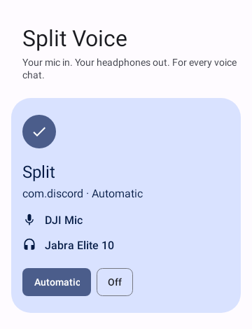

# Split Voice

Talk through a wireless mic and listen through Bluetooth LE Audio headphones in any Android voice chat. Android does not let you choose this. Split Voice does it with [Shizuku](https://shizuku.rikka.app/), without root.



## Get started

You need Android 16 or later, a mic receiver that plugs into USB-C, and headphones with LE Audio turned on.

Install the APK from [Releases](https://github.com/meatcar/split-voice/releases/latest), or add `https://github.com/meatcar/split-voice` to [Obtainium](https://obtainium.imranr.dev/) for updates. Then follow [your first split](docs/tutorial.md).

## Documentation

- [Tutorial](docs/tutorial.md): set up and make your first split.
- [How-to guides](docs/how-to.md): Quick Settings, automatic split, after a restart, restore, uninstall, report a problem.
- [Reference](docs/reference.md): screen and tile states, every message, options, permissions, diagnostics.
- [How it works](docs/explanation.md): why this needs Shizuku and how your audio stays safe.
- [Compatibility](docs/compatibility.md): tested phones and devices.

Split Voice does not record audio and has no internet or microphone permission. See [PRIVACY.md](PRIVACY.md).

## Build

On Linux with [Nix](https://nixos.org/download/):

```sh
git clone https://github.com/meatcar/split-voice.git
cd split-voice
nix develop -c ./check
```

The APK is at `app/build/outputs/apk/debug/app-debug.apk`. See [CONTRIBUTING.md](CONTRIBUTING.md) for development instructions.

## Disclaimer

Split Voice uses hidden Android audio APIs and changes system-wide routing. Results vary by phone and Android version. Restore before you uninstall it. Report what works for you in a [compatibility report](https://github.com/meatcar/split-voice/issues/new?template=compatibility.yml).

## Credits and license

Inspired by [BTMicFix](https://github.com/Endda/BTMicFix) by Endda. Built with [Shizuku](https://shizuku.rikka.app/) and [meatcar/nix-templates](https://github.com/meatcar/nix-templates).

By [Denys](https://denys.me). Licensed under [Apache-2.0](LICENSE). Dependency notices are in [THIRD_PARTY_NOTICES](THIRD_PARTY_NOTICES).
